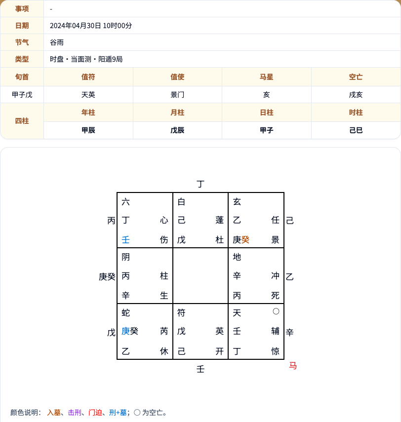

# Yinpan Qimen Dunjia Chart Calculator · 阴盘奇门遁甲排盘

[简体中文](README.md) | **English**

A browser-based **Yinpan Qimen Dunjia** chart calculator developed and maintained by **Ruoxuan (若轩)**. Supports hourly and ten-minute charts, automatic or manual Ju selection, and apparent solar time. All calculations run locally, without a backend.

**Xuanyuan Guoxue (轩辕国学): [https://qimen.aifashou.cn/](https://qimen.aifashou.cn/)**

## Why share it

I am Ruoxuan. I started this project after finding Qimen tools with missing features or incorrect chart results. I spent considerable time comparing reference charts, tracing discrepancies, and correcting the implementation, checking details such as Ju selection, Zi-hour day boundaries, ten-minute charts, and hidden stems. Cases prone to mistakes became repeatable tests.

Chart accuracy has been a priority throughout that work. I want the calculation rules and reference cases to be easy to inspect and verify. I am sharing this tool to promote traditional Chinese culture and help more people learn, use, study, and improve it.

## Official application

[](https://qimen.aifashou.cn/qimen-paipan)

The screenshot shows the official Xuanyuan Guoxue charting interface. For symbol meanings, star-shifting tools, AI-assisted interpretation, and the full application, visit:

[https://qimen.aifashou.cn/qimen-paipan](https://qimen.aifashou.cn/qimen-paipan)

## Features

- **Hourly and ten-minute charts**: generate Yinpan charts for everyday use and comparisons at finer time intervals.
- **Automatic or manual Ju selection**: calculate Ju from the year branch, lunar month and day, and hour branch, or choose 1–9 manually for study and reference-chart checks.
- **Explicit time rules**: use Beijing time consistently and start a new day at 23:00. Optional apparent solar time correction uses longitude and the equation of time to reduce differences caused by device time zones and time conventions.
- **Complete chart essentials**: display the Four Pillars, Xun Shou, Zhi Fu, Zhi Shi, void branches, travelling horse, and the deities, stars, gates, heaven/earth stems, and outer hidden stems in a conventional nine-palace layout.
- **Verifiable calculations**: 14 regression cases cover Yin/Yang Dun, hourly and ten-minute charts, early/late Zi hours, a solar-time boundary, and hidden stems in partial/full Fu Yin. Run them after changes to check consistency.
- **Lightweight local calculation**: charts are generated in the browser, with input processed locally. Works on phones and computers and can be self-hosted or extended.

## Getting started

### Method 1: Run the code

Requires Node.js 22. Download the repository, enter its directory, and run:

```sh
git clone https://github.com/magiclaw/yinpan-qimen-dunjia.git
cd yinpan-qimen-dunjia
npm ci
npm run dev
```

Open <http://127.0.0.1:5188/>.

```sh
npm test          # Check 14 chart regression cases
npm run build     # Static output in dist/
```

### Method 2: Ask an AI assistant to run it

Send this repository's GitHub URL to an AI coding assistant that can execute code, for example:

```text
Please run this project in a separate directory: https://github.com/magiclaw/yinpan-qimen-dunjia
Install its dependencies, start a local preview, and give me the URL.
```

Built with React, Vite, and lunar-typescript. See [calculation notes](docs/calculation.md) (Chinese).

## Contributing

To report a chart discrepancy, include the input time, chart mode, Ju selection, solar-time settings, and a reference chart in an Issue. Fixes and regression cases are welcome.

License: [MIT](LICENSE). Modify, deploy, and use it in your own projects while retaining the copyright and license notice.

Author: **Ruoxuan (若轩)** · Xuanyuan Guoxue: [https://qimen.aifashou.cn/](https://qimen.aifashou.cn/)
